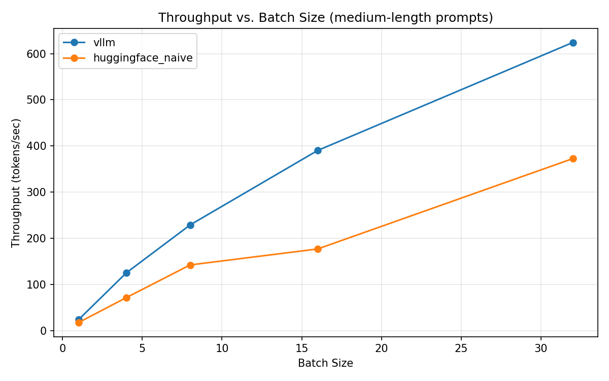
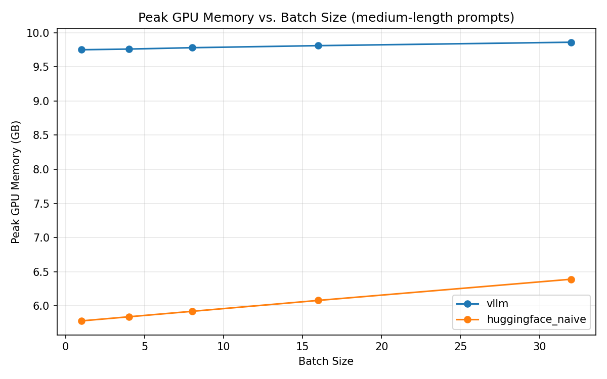

# vLLM Inference Benchmark: Throughput & Memory vs. Naive HF Serving

A benchmark that answers a specific, practical question: how much do you actually gain by
serving an LLM with [vLLM](https://github.com/vllm-project/vllm)'s continuous batching and
PagedAttention, instead of the naive `model.generate()` loop most people reach for first?

The short answer: **a consistent 1.6-2.2x throughput improvement**, on prompts where both
engines do a genuinely equal amount of work. The longer answer — including a sampling bug
this project found in its own methodology, fixed, and then found a second, deeper issue
underneath it — is in [`results/RESULTS.md`](results/RESULTS.md).

## Why this exists

Most of my production LLM work (VITG, CARDS, Silicon Oracle) has run on managed inference —
AWS Bedrock, the Gemini API, local Ollama. Someone else's infrastructure team already made
the serving-engine decision. This project exists to close that gap: to actually run a
self-hosted, high-throughput serving engine, measure it properly, and understand *why*
PagedAttention and continuous batching outperform the naive approach, rather than taking
that claim on faith.

**Scope, stated precisely:** this compares vLLM's continuous-batching engine against naive,
unbatched HuggingFace `.generate()` calls, on a single GPU, with a single model instance, no
quantization. It says nothing about vLLM versus other serving engines (TGI, TensorRT-LLM,
SGLang; an SGLang baseline is wired up but not yet run, see below), and nothing about
multi-GPU or tensor/pipeline parallelism. The claim under test is
narrow and defensible: *vLLM's scheduling and memory management beat the naive unbatched
approach under these conditions* — not "vLLM is the fastest engine that exists."

## Three findings, not one

Most benchmark write-ups report a single number and move on. This one surfaced three things
worth knowing, and the second one is arguably more interesting than the headline:

**1. The throughput gain is real and consistent.** On prompts where both engines are
verified to generate the identical number of tokens, vLLM wins by 1.6-2.2x at batch sizes
4 and above. The gain shows up even at batch size 1, though more modestly (1.15-1.35x) —
expected, since vLLM's advantage comes from scheduling across concurrent requests, and
there's nothing to schedule with only one request in flight.



**2. Fixing a sampling bug revealed a second, more interesting one.** The first run left
both engines' random seeds unfixed. Since both sample at `temperature=0.7`, they generated
different amounts of text on prompts that stop early — which meant part of the "speedup"
being measured was actually just one engine writing more words than the other. Seeding both
engines identically fixed this completely for medium- and long-length prompts. It did *not*
fix it for short prompts: even with a matched seed, HF's baseline still generates roughly
2-2.5x more tokens than vLLM on the same short input. That's not a seeding bug — it's vLLM
and HF `transformers` reaching different EOS/early-stopping decisions independently of the
seed, using different sampling kernels. Rather than paper over that with a caveat, this
project reports it as a distinct, unresolved finding and excludes short-prompt numbers from
the headline claim.

**3. The memory chart looks backwards until you know why.** vLLM's peak GPU memory sits flat
around 9.75-10.13GB no matter the batch size, while the naive baseline grows from 5.77GB to
6.52GB as batch size increases. Read naively, that says "vLLM uses more memory" — which is
the wrong conclusion. vLLM reserves a large KV-cache pool *upfront*, at startup
(`gpu_memory_utilization=0.85`), so what's being measured is a large fixed reservation, not
per-request growth. The naive baseline allocates on demand, so its memory use tracks load
directly — which also means it has no headroom against a load spike. The honest framing:
vLLM trades a bigger reserved footprint for flat, predictable scaling.



## What's measured

- **Throughput** — tokens/sec at batch sizes 1, 4, 8, 16, 32, across short/medium/long prompts
- **Latency** — time-to-first-byte and P50/P90/P99 per-token latency
- **Memory** — peak GPU memory, PagedAttention's upfront pool vs. naive on-demand allocation
- **A fixed sampling seed (42)** across both engines, so the comparison is reproducible and
  the confound in Finding 2 above doesn't recur silently

## Setup used for the reported results

| | |
|---|---|
| GPU | Google Colab T4 (16GB VRAM) |
| Model | `Qwen/Qwen2.5-3B-Instruct`, fp16 |
| Sampling | temperature=0.7, max_new_tokens=256, seed=42 (both engines) |

## Running it yourself

**Colab (recommended — no local GPU required).** Open
[`vLLM_vs_Naive_HF_Benchmark.ipynb`](vLLM_vs_Naive_HF_Benchmark.ipynb), select a T4-or-better
GPU runtime, and run all cells in order. It installs dependencies, writes out `config.py` /
`run_vllm.py` / `run_baseline.py`, runs both benchmarks, generates the comparison plots, and
zips `results/` + `plots/` for download.

**Local GPU.** The same benchmark logic as standalone scripts:

```bash
pip install -r requirements.txt

python benchmark_vllm.py --model Qwen/Qwen2.5-3B-Instruct --output results/vllm_results.json
python benchmark_baseline.py --model Qwen/Qwen2.5-3B-Instruct --output results/baseline_results.json
python analyze_results.py --vllm results/vllm_results.json --baseline results/baseline_results.json
```

## SGLang baseline (pending run)

A third engine, [SGLang](https://github.com/sgl-project/sglang), is set up but **has not been
run yet, so there are no SGLang numbers in this repo**. They will be added after a GPU run;
none are estimated or carried over from elsewhere.

- **Method.** `benchmark_sglang.py` uses SGLang's offline `sglang.Engine` (no HTTP server in
  the measured path) and mirrors `benchmark_vllm.py`: same `prompts.py`, batch sizes 1-32,
  `max_new_tokens=256`, `temperature=0.7`, `top_p=1.0`, seed 42, same output schema, written
  to `results/sglang_results.json`. Every engine now records `tokens_per_request`, and the
  summary flags which cells generated equal total tokens across all three engines, so
  throughput is only compared on equal work (the Finding 2 lesson).
- **Version / GPU.** Current SGLang needs sm80+ (Ampere); the T4 is sm75. The repo pins
  `sglang==0.4.6.post5` (torch 2.6, triton 3.2, sm75 kernels), the newest release expected to
  run on a T4, with SGLang's documented Triton-attention / PyTorch-sampling fallback for
  Turing. If that fails, an L4 or A10 with a current SGLang is the fallback, and then vLLM and
  the baseline have to be re-run on the same card. Reasons and sources are in
  [`requirements-sglang.txt`](requirements-sglang.txt).
- **Measured differently, on purpose.** SGLang runs the model in a separate scheduler
  process, so peak memory comes from NVML (device-level, includes the CUDA context) rather than
  `torch.cuda.max_memory_allocated()`. TTFB comes from a separate streaming pass, so it never
  touches the throughput number. The pinned SGLang has only an engine-wide seed, not a
  per-request one.
- **Run it.** Open [`SGLang_Baseline.ipynb`](SGLang_Baseline.ipynb) on a Colab T4, or in a
  separate environment from vLLM:

```bash
pip install -r requirements-sglang.txt
python benchmark_sglang.py --model Qwen/Qwen2.5-3B-Instruct --output results/sglang_results.json
python analyze_results.py   # picks up results/sglang_results.json automatically when present
```

`analyze_results.py` adds SGLang as a third series to both plots and to the summary table
when that file exists, and falls back to the two-engine output when it does not. GPU-free
checks: `pip install pytest pandas matplotlib numpy && python -m pytest tests/`.

## Project structure

```
vllm-inference-benchmark/
├── vLLM_vs_Naive_HF_Benchmark.ipynb   Colab notebook — the primary path for these results
├── benchmark_vllm.py                  standalone vLLM engine benchmark harness
├── benchmark_baseline.py              standalone naive HF transformers.generate() baseline
├── benchmark_sglang.py                SGLang offline-Engine benchmark (third engine, pending run)
├── SGLang_Baseline.ipynb              Colab notebook for the SGLang run (T4, pinned 0.4.6.post5)
├── prompts.py                         fixed short/medium/long prompt set, for reproducibility
├── analyze_results.py                 comparison plots + markdown summary report
├── requirements.txt
├── requirements-sglang.txt            separate env for SGLang (different torch pin)
├── tests/                             GPU-free checks: results schema, 2- and 3-engine analysis
├── results/
│   ├── vllm_results.json / baseline_results.json   raw benchmark output
│   ├── SUMMARY.md                     per-batch throughput and memory tables
│   └── RESULTS.md                     the full write-up: all three findings, in detail
└── plots/                             throughput_vs_batch.png, memory_vs_batch.png
```

## Status

vLLM vs. naive HF: complete. SGLang baseline: code and notebook ready, GPU run pending.
Results generated on a Google Colab T4 running `Qwen/Qwen2.5-3B-Instruct`. Read
[`results/RESULTS.md`](results/RESULTS.md) for the full analysis, or
[`results/SUMMARY.md`](results/SUMMARY.md) for the raw per-batch numbers.
